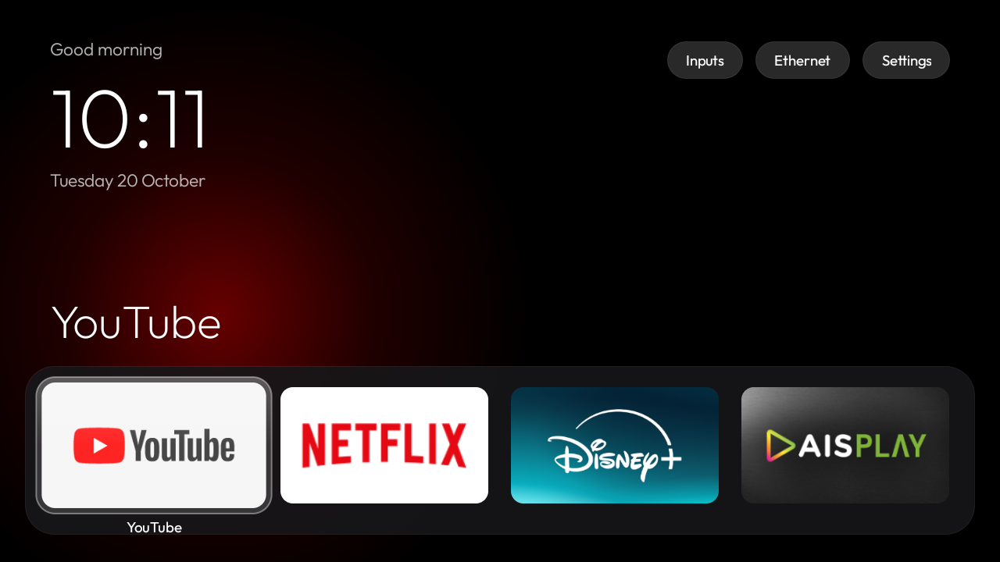
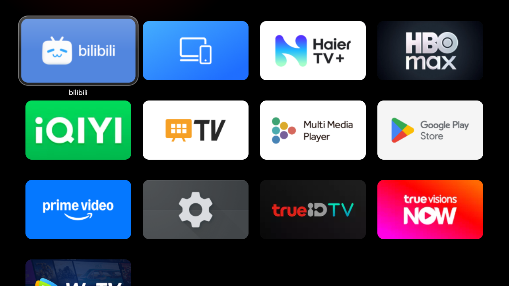
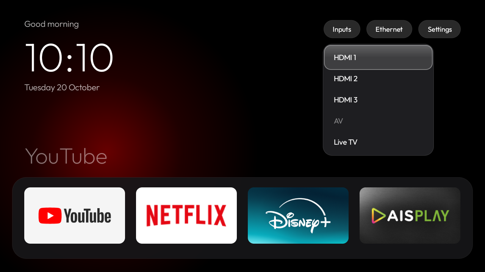

# Haier H32S80EFX (Google TV): debloat + launcher สไตล์ Apple TV

[English](README.md)

วิธีลบโฆษณาและแอปแถมของผู้ผลิตออกจาก **Haier H32S80EFX** (Google TV 14, `Haier MatrixTV CE`,
เฟิร์มแวร์ `UKNV.260302.001`, RAM 1.4 GB) และเปลี่ยนหน้า Home เป็น launcher เบาๆ สไตล์ Apple TV
ทดสอบกับทีวีจริงแล้ว ทุกอย่างย้อนกลับได้: ไม่มีการถอนการติดตั้ง ใช้แค่ `pm disable-user` และมี `tools/restore.ps1` ไว้เปิดคืน

| Home | ตารางแอป | Inputs |
|---|---|---|
|  |  |  |

## สิ่งที่พบบนทีวีรุ่นนี้

ข้อมูลเครื่องและ**รายการแพ็กเกจทั้ง 160 ตัว พร้อมบอกว่าตัวไหนปิดได้/ห้ามปิด**: [examples/haier-h32s80efx.md](examples/haier-h32s80efx.md)

- ติดตั้ง APK เองได้ด้วย `pm install` รวมถึงแอปที่ประกาศตัวเป็น HOME
- ใช้แค่ `cmd package set-home-activity` อย่างเดียวไม่พอ เพราะ launcher Google TV (priority 2) และ setupwraith
  (priority 1) แย่งเป็น Home ก่อนเสมอ ต้องปิดทั้งสองตัว (ปิดแค่ `RecoveryActivity` ของ setupwraith ไม่ได้ ระบบไม่ยอม)
- **ก่อนปิด setupwraith** ให้รัน `adb shell cmd wifi list-networks` ก่อน ถ้า Wi-Fi ถูกบันทึกไว้ตอนตั้งค่าเครื่องครั้งแรก
  Android จะลบเครือข่ายนั้นทิ้งเมื่อปิด setupwraith ทำให้ทีวีหลุดจาก Wi-Fi และ ADB
  ถ้าใช้ Wi-Fi ให้กด Forget แล้วเชื่อมต่อใหม่ใน Settings ก่อน
- ภาพหน้าจอขณะดู Live TV/HDMI จะออกมาว่าง เป็นข้อจำกัดของทีวี ให้ใช้ `dumpsys activity activities | grep topResumedActivity` ตรวจแทน
- ดิจิทัลทีวีไทยเป็น DVB-T2: ทีวีมีจูนเนอร์ 3 ตัว และ Live TV ต้องเปิดตัวดิจิทัล (`TunerInputService`) ไม่ใช่ตัวแอนะล็อก

## ขั้นตอน

ต้องมี Windows + PowerShell, [Platform-Tools](https://developer.android.com/tools/releases/platform-tools) ที่
`C:\temp\platform-tools` และเครื่องมือ build (JDK 17, Android SDK 34, Gradle 8.7) ที่ `C:\temp\build-tools`

บนทีวี: Settings → System → About → กด OK ที่ **Android TV OS build** 7 ครั้ง แล้วเปิด **USB debugging** ใน Developer options
เชื่อมต่อครั้งแรกให้กด OK ที่กล่อง "Allow USB debugging?"

1. สำรองข้อมูล: `powershell -ExecutionPolicy Bypass -File tools\backup.ps1 -Tv <ip ทีวี>`
2. Debloat (3 ชุด ถ่ายภาพหน้าจอทุกชุด): `tools\debloat.ps1 -Tv <ip ทีวี>`
   ปิดแอปสตรีมมิ่งที่ไม่ใช้เพิ่มด้วย `tools\disable.ps1 -Tv <ip ทีวี> -Name extra -Packages <แพ็กเกจ>`
3. แก้แอปใน dock ที่ `launcher/app/src/main/res/values/config.xml` (`dock_packages` เรียงจากซ้ายไปขวา)
4. Build และติดตั้ง: `tools\build-install.ps1 -Tv <ip ทีวี>`
5. ตั้งเป็น Home (อ่านคำเตือนเรื่อง setupwraith ก่อน):
   `pm disable-user --user 0 com.google.android.apps.tv.launcherx`,
   `pm disable-user --user 0 com.google.android.tungsten.setupwraith`,
   `cmd package set-home-activity com.local.atvhome/.MainActivity`
6. ใช้เสร็จแล้วปิด ADB: Revoke USB debugging authorisations, ปิด USB debugging, รีสตาร์ททีวี
   แล้วตรวจว่า `Test-NetConnection <ip ทีวี> -Port 5555` ได้ `False`

รายการแพ็กเกจที่ปิดและที่ห้ามปิดอยู่ใน [README.md](README.md#what-gets-disabled)

## ย้อนกลับ

`powershell -ExecutionPolicy Bypass -File tools\restore.ps1 -Tv <ip ทีวี>` จะเปิดทุกแอปที่ปิดไปหลังจากสำรองข้อมูล และตั้ง launcher Google TV กลับเป็น Home
เปิดทีละตัว: `adb shell pm enable --user 0 <แพ็กเกจ>` ลบ launcher: `adb uninstall com.local.atvhome`

## Wallpaper

วางรูปที่ `launcher/app/src/main/res/drawable-nodpi/wallpaper.jpg`, ตั้ง `use_wallpaper` เป็น `true` ใน `config.xml` แล้ว build ใหม่

ไม่มีส่วนเกี่ยวข้องกับ Haier, Google หรือ MediaTek ใช้งานด้วยความรับผิดชอบของคุณเอง
